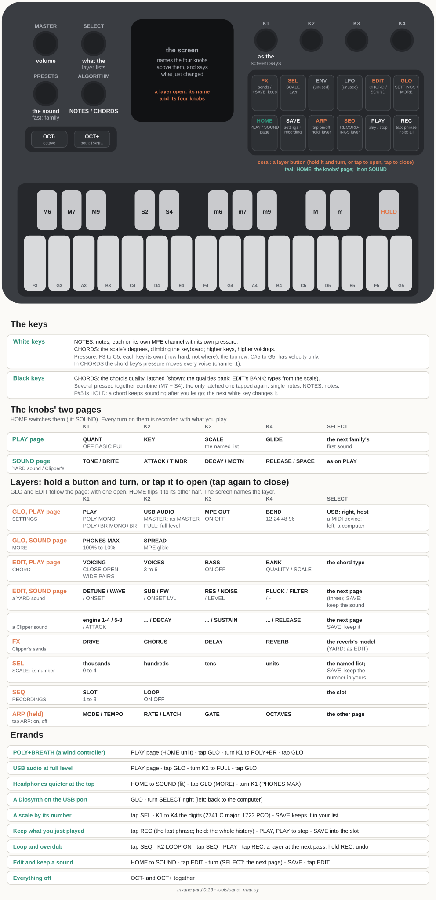

# mvane yard manual (0.16)

mvane yard is a performance firmware for the M-VAVE FM-1, on [The Firmware Hub](https://thefirmwarehub.com/). Play
notes or chords from any of 4096 scales, through YARD (mvane yard's own synth, 13 sounds) or Clipper's 337 factory
sounds, with MPE and breath, while a recorder keeps everything you play: keep a phrase after the fact, loop it,
overdub it, move it to another key or scale, save it in one of eight slots, take it to your computer as MIDI.

The knob pages and layers as an accessible table: [the cheat sheet](https://enkerli.github.io/mvane-yard/cheatsheet.html)
(also on [the page](https://enkerli.github.io/mvane-yard/#controls)); tasks to learn or test the panel, their answers
hidden: [try it](https://enkerli.github.io/mvane-yard/tasks.html).

## Install

From The Firmware Hub (Install, in Chrome or Edge), or with **M-Flasher**: install `mvane-yard-X.Y.fwsc`. Back up
the firmware you have first (M-Flasher does it before it installs). Your settings, sounds and recordings stay across
updates. The same firmware plays in **VIBE FM VST** (the plugin) two ways: converted by the Hub (`mvane yard`), or
native (`mvane yard native`, below).

## The first five minutes

- **It starts** in CHORDS, key C, MAJOR (2741), QUANT BASIC, the sound SAW, POLY; chords of five voices and a bass,
  OPEN; the qualities bank with **M7** latched; MPE OUT on, BEND 48, USB AUDIO FULL, PHONES MAX 100%; the ARP off
  (UP, 1/16, 50%, one octave, 120 BPM); recording slot 1, LOOP off.
- **The first white key, F3, is the key's tonic**; the white keys climb the scale's degrees from there.
- **Chords that follow the scale**: a quality (a black key) is the same whatever the scale, so in MINOR the M7
  latched still plays major sevenths. For chords from the scale, set QUANT to FULL (PLAY page, K1), or EDIT's BANK to
  SCALE; or latch the minor qualities (m7).
- **Pick the slot before you keep a recording**: changing slots with a recording not saved warns (NOT SAVED, AGAIN:
  LEAVE IT) and a second turn leaves it unsaved; what you played is still in the history, so REC can keep it again.
- **SAVE** keeps the settings as they are now; without it, a restart brings back the last ones saved.

## The panel in three ideas

1. **Two knob pages.** K1 to K4 are either the **PLAY** page (QUANT, KEY, SCALE, GLIDE) or the **SOUND** page (the
   sound's four main values). **HOME** switches them; HOME is lit on SOUND. The screen names the four knobs above
   them, always.
2. **Layers.** FX, SEL, EDIT, GLO, SEQ and ARP each change what K1 to K4 and SELECT do. **Hold** the button and turn
   (let go: back), or **tap** it to leave the layer open and tap it again to close it. The screen names the open
   layer. **EDIT and GLO follow the page**: on PLAY, EDIT is the CHORD layer and GLO the SETTINGS; on SOUND, EDIT is
   the sound's editing and GLO is MORE. With one of them open, HOME flips it to its other half.
3. **SELECT moves through what the layer lists**: on the pages, the sound families; in a layer, its list (the chord
   type, the slot, the scale, the next page).

ENV and LFO do nothing in mvane yard yet.

## Errands

| To | Do |
| --- | --- |
| Play with a wind controller (POLY+BREATH) | On the PLAY page (HOME unlit): tap GLO, turn K1 to POLY+BR (or MONO+BR), tap GLO |
| Record the FM-1 into the computer at full level | PLAY page: tap GLO, turn K2 to FULL (MASTER: it follows the volume), tap GLO |
| Make the headphones quieter at the top | HOME to SOUND (lit): tap GLO (MORE), turn K1 (PHONES MAX), tap GLO |
| Make it louder in headphones | HOME to SOUND: tap GLO (MORE), turn K3 (LOUD) to +3 DB or +6 DB, tap GLO |
| Host a USB MIDI device (a Diosynth) | GLO, turn SELECT right; left: back to the computer (see USB) |
| Use a scale by its number | Tap SEL, set the digits with K1 to K4 (2741 C major, 1723 PCO); SAVE keeps it in your list; tap SEL |
| Keep what you just played | Tap REC: the last phrase (hold REC: the whole history); PLAY to hear it, PLAY to stop; SAVE into the slot |
| Loop and overdub | Tap SEQ, K2 LOOP ON, tap SEQ; PLAY; tap REC: a layer from the next pass; tap REC again: stop at its end; hold REC: undo the last |
| Another slot | Tap SEQ, turn SELECT (or K1), tap SEQ |
| Edit a sound and keep it | HOME to SOUND, tap EDIT, turn (SELECT: the next page), SAVE, tap EDIT |
| Everything off | OCT- and OCT+ together |

## The screen

| Where | What |
| --- | --- |
| Top left | NOTES or CHORDS (ARP or ARP LATCH beside it while the arpeggiator runs; USB HOST, lit, while the port hosts a device); for a moment after you change something, what changed |
| Top right | The sound |
| Middle (CHORDS) | The chord sounding (or the last one, dimmed); below: key, scale, chord type (IN SCALE on QUANT FULL: the quality bent to the scale), voicing, voices + BASS, the pitch-class set's number, HOLD |
| Middle (NOTES) | The notes held |
| Knob row | What K1 to K4 do now, the one you turn lit, with its value |
| A layer open | Its name, its four knobs, and what SELECT does |
| HISTORY | How much playing the history holds, % FULL; ASLEEP once you stop playing; FULL: SAVE when it has reached a recording not yet saved |
| RECORDING n/8 | The recording in the slot, its length; PLAYING, LOOPING, OVERDUB n, NOT SAVED |
| Bottom | CPU (x2 while the second core renders half the voices), XR (missed audio deadlines: should stay 0; with n SW near a change of sound, n FL near a flash write), PK and SW (the worst block since the last change of sound, and in the second after it, in % of a block's time), Q (events lost and repaired), the sound's cost (EZ, HRD), HOST, the play mode (MONO SOUND: a mono sound under POLY) |

## Controls

### The knob pages (HOME switches them)

| Page | K1 | K2 | K3 | K4 |
| --- | --- | --- | --- | --- |
| **PLAY** (as Coral Flower's) | QUANT (OFF, BASIC, FULL) | KEY | SCALE (the named list) | GLIDE |
| **SOUND**, a YARD sound | TONE | ATTACK | DECAY | RELEASE |
| **SOUND**, a Clipper sound | BRITE | TIMBR | MOTN | SPACE (Clipper's four macros) |

On both pages SELECT goes to the next family's first sound. Every turn on these pages is recorded with what you play
(CC 5, 16 to 19, 72 to 75), so a recording replays it.

### The layers (hold the button and turn; or tap it open, tap it closed)

| Layer | K1 | K2 | K3 | K4 | SELECT |
| --- | --- | --- | --- | --- | --- |
| **GLO** on the PLAY page: SETTINGS | PLAY (POLY, MONO, POLY+BR, MONO+BR) | USB AUDIO (MASTER: at the volume; FULL: full level) | MPE OUT (ON, OFF) | BEND (12, 24, 48, 96) | the USB port: right, host to a MIDI device; left, a computer |
| **GLO** on the SOUND page: MORE | PHONES MAX (100% to 10%) | SPREAD (MPE glide: OFF, 100% to 400%) | LOUD (OFF, +3 DB, +6 DB: the output's compressor) | | |
| **EDIT** on the PLAY page: CHORD | VOICING (CLOSE, OPEN, WIDE, PAIRS) | VOICES (3 to 6) | BASS (ON, OFF) | BANK (QUALITY, SCALE) | the chord type |
| **EDIT** on the SOUND page, a YARD sound (three pages) | DETUNE / WAVE / ONSET | SUB / PW / ONSET LVL | RES / NOISE / LEVEL | PLUCK / FILTER / - | the next page; SAVE keeps the sound |
| **EDIT** on the SOUND page, a Clipper sound (three pages) | its engine's values 1 / 5 / ATTACK | 2 / 6 / DECAY | 3 / 7 / SUSTAIN | 4 / 8 / RELEASE | the next page; SAVE keeps the sound |
| **FX**, a Clipper sound | DRIVE | CHORUS | DELAY | REVERB (sends; CC 12, 93, 94, 91) | the reverb's model; SAVE keeps the sound |
| **FX**, a YARD sound | as EDIT on the SOUND page | | | | |
| **SEL**: SCALE | thousands (0 to 4) | hundreds | tens | units (at most 4095) | the named list, then yours; SAVE keeps the number in your list |
| **SEQ**: RECORDINGS | SLOT (1 to 8) | LOOP (OFF, ON) | | | the slot |
| **ARP** (PLAY while ARP is lit: the ARP on, off) | MODE / TEMPO | RATE / LATCH | GATE | OCTAVES | the other page |

### Buttons and encoders

| Control | Does |
| --- | --- |
| **MASTER** | The volume (PHONES MAX sets its top for the headphones and speaker) |
| **ALGORITHM** | NOTES (left) / CHORDS (right) |
| **PRESETS** | The sound, by family; in each, YARD's first, then yours, then Clipper's (a fast turn: the next family) |
| **SELECT** | What the layer lists (above); on the pages, the next or previous family's first sound |
| **HOME** | The PLAY page / the SOUND page (lit); with GLO or EDIT open, their other half |
| **OCT- / OCT+** | The octave (-2 to +2); both together: panic, everything off |
| **REC** | Tap: keep the last phrase (everything since the last 3 s of silence). Hold: keep the whole history. While a recording loops: tap, overdub from the next pass (again: stop at its end); hold, undo the last layer |
| **PLAY** | Play / stop the recording. While ARP is lit (its layer open or held, or the arpeggiator running): the arpeggiator on, off; with SEQ's open or held as well: both together |
| **SAVE** | The settings, and the recording into its slot (stop it first). With SEL open: the scale into your list. With FX open, or EDIT on the SOUND page: the sound |
| **ARP** | Its layer, as the others; lit while open or running (PLAY then: the arpeggiator on, off) |
| **FX, SEL, EDIT, GLO, SEQ, ARP** | Their layers (above) |
| **ENV, LFO** | Nothing yet |

## Playing

### The keys

- **White keys**: in NOTES, notes from F3 (OCT moves them); in CHORDS, the scale's degrees, climbing the keyboard
  (higher keys are voiced higher).
- **Velocity** on every key. **Pressure** on the 20 keys from F3 to C5, each its own: how much harder you press than
  the key rests (not where your finger sits: the keys have no Y axis). The top row, C#5 to G5, has velocity only. In
  NOTES, with MPE OUT on, each note goes out on its own MPE channel with its own pressure (so a DAW or an MPE synth
  hears each note's pressure apart); in CHORDS, the chord key's pressure goes to channel 1 and moves every voice.
- **Black keys**: in NOTES, notes; in CHORDS, the chord's type (below). F#5 is HOLD in CHORDS.

### CHORDS

- **Black keys** pick the chord type and stay latched (lit). A chord sounding takes the new type at once.
  - **Combine** (as Coral Flower): press black keys together, and they latch together. In the qualities bank they
    merge: the third held most wins (on a tie, the last pressed), a quality with the other third is left out, the
    added degrees join, and a sus with a third adds its 2nd or 4th: M6 + M9 is 6/9, M7 + S4 is maj7 add4, S2 + S4 is
    sus2 add4. The screen shows them as M6+M9. (In the scale bank the last one pressed counts.)
  - **Single notes**: tap the only latched key again, and it unlatches; the white keys then play the degree's root
    alone (NOTE on screen). Latch a quality while a note sounds, and it opens into the chord, its voices gliding from
    the note.
  - **The qualities bank** (the default, Coral Flower's top row): **M6 M7 M9 S2 S4 m6 m7 m9 M m**, on the white
    key's root whatever the scale says.
  - **The scale bank** (EDIT's BANK: SCALE): **STACK** (thirds of the scale: 7th, 9th, then 13th and 11th), **7**,
    **TRIAD**, **ADD9**, **SUS**, **6/9**, **QUARTAL**, **11** (no third), **FIFTHS**, **V/** (the degree's
    dominant).
- **F#5 is HOLD**: a chord keeps sounding after you let its key go; the next white key changes it; HOLD again stops
  it. A held chord follows a change of sound.
- Every chord has a separate **bass** (EDIT: BASS) and 3 to 6 **upper voices** (EDIT: VOICES).
- **Voice leading**: each chord is voiced from the one before, so the voices move as little as they can; notes the
  two chords share are held, the moving voices glide (GLIDE sets how long).
- **Voicings** (EDIT: VOICING): CLOSE (within about an octave), OPEN (drop-2-like), WIDE (every gap a fourth or
  more), PAIRS (the 3rd and 7th low, the root and 5th above: two pairs of fifths; more voices on top).
- **MPE glide** (GLO on SOUND: SPREAD up; MPE OUT on): each moving voice glides in its own time, the lowest in
  GLIDE's, the highest up to four times longer, so a change of chord blooms rather than moving as a block. It is
  plain MPE (each new note starts bent to the note it takes over and eases back), so YARD, Clipper and an MPE synth on
  MPE OUT glide alike, and a recording keeps it. SPREAD OFF: the sounds' own glide.

### QUANT (to the scale, not in time; as Coral Flower's)

- **OFF**: CHORDS: the white keys are roots a semitone apart, the tonic on the fifth key. NOTES: as printed.
- **BASIC** (the default): CHORDS: the white keys are the scale's degrees. NOTES: each key snaps to the nearest tone
  of the scale (down on a tie: C# to C in C major).
- **FULL**: as BASIC, and each tone of a fixed quality snaps to the scale too (the chords become diatonic), and so do
  the notes coming in over MIDI (USB, TRS, a hosted device). A note's release finds the note it became, even after the
  scale or QUANT has changed.

### Scales: pitch-class sets

**A scale is a number**, 0 to 4095, as in the Music Suite: each of the twelve semitones above the key is a bit (the
key 1, a semitone up 2, a whole tone up 4 ... the major seventh 2048), and the scale is their sum. C major is 2741
(1 + 4 + 16 + 32 + 128 + 512 + 2048), the minor 1453, the whole-tone scale 1365, the chromatic 4095. The key is
always in: an even number plays as the next odd one. SEL's layer shows the number, its name when it has one, and the
twelve semitones from the key (the key lit). It is saved with the settings.

**The named list**, on the PLAY page's SCALE and on SEL's SELECT, bright to dark: LYDIAN, MAJOR (the default),
MIXOLYDIAN, DORIAN, MINOR, PHRYGIAN, LOCRIAN; MAJ PENTA, SUS PENTA, MIN PENTA; MAJ BLUES, MIN BLUES; MEL MIN, HARM
MIN; WHOLE TONE, OCT H-W, OCT W-H, AUGMENTED; PCO (1723) and NOODLING (1267); CHROMATIC. Then **your own** (up to 16):
on SEL's layer, set a number and SAVE. The page names, renumbers and removes them; one without a name shows as its
number.

**Known names**: dial a number and the screen names it when it is a known scale, listed or not (HIRAJOSHI 397,
PERSIAN 2419, the bebop scales, Messiaen's modes ...: about 60). All 4096 are on
[Ian Ring's list](https://ianring.com/musictheory/scales/), by the same numbers. The page's scale editor: tick a
scale's notes, pick a known scale, or type its number.

### ARP

**ARP is a layer like the others**: hold it, or tap it open (tap again to close). **PLAY turns the arpeggiator on
and off while ARP is engaged**: its layer open or held, or the arpeggiator running (the ARP button lit, even with its
layer closed). The screen says ARP, or ARP LATCH; ARP and PLAY light while it runs. With SEQ's layer open or held as
well, PLAY starts the arpeggiator and the recording together, and stops both if either runs. A chord that sounds (its
key held, or HOLD) goes into the arpeggiator when it starts, and sounds again as a chord when it stops; so do the
keys held in NOTES. Changing the sound while it runs keeps its notes. The layer's knobs: MODE (UP, DOWN,
UP-DOWN, DOWN-UP, UP+DOWN, RANDOM, AS PLAYED, CHORD, SCALE), RATE (1/4, 1/8, 1/8T, 1/16, 1/16T, 1/32), GATE (5% to 100%),
OCTAVES (1 to 4); SELECT: TEMPO (40 to 240 BPM) and LATCH. It plays what would sound, a step at a time: in NOTES the
keys you hold, in CHORDS the chord's voices (the bass too), and the notes coming in over MIDI. UP-DOWN and DOWN-UP
turn at the ends without repeating them, UP+DOWN repeats them, RANDOM never plays the same twice in a row, CHORD plays
them all together (a comping rhythm), **SCALE** (0.16) plays a random tone of the scale, from the lowest note held up
OCTAVES octaves, never the same twice in a row (weights by degree, the root most, are on the roadmap). Each note goes out on its key's channel at its velocity, so that key's pressure
shapes it. **LATCH** keeps the notes after you let go; a new press after letting go of everything starts a new set.
A recording keeps what the ARP played, and is not arpeggiated again when it plays. Its settings are kept with SAVE;
ON and LATCH are not (it starts off).

### MPE, wind controllers, MIDI in

- **MIDI in** (USB or the TRS jack) plays the sound with MPE: per-note pitch bend (the range from RPN 0, 48 by default
  on member channels), slide (CC 74 on a member channel, centred on 64), channel and poly pressure. mvane yard sends
  an MPE configuration message when a computer connects.
- **Breath** (GLO, K1: POLY+BR or MONO+BR): CC 2 or CC 11 from a wind controller sets the level and the brightness;
  notes are silent until you blow (tried with a Diosynth). Each channel's breath is its own; the panel's keys follow
  the latest from any. POLY+BR plays the sound's voices, MONO+BR one, legato.
- **While a recording plays**, MIDI in moves out of its way: what comes in on channel 1 or on a channel the recording
  uses goes to a member channel it does not use, the highest free first, so each overdub from a one-channel
  controller lands on a channel of its own.
- **MONO** is legato: a note played over a held one slides to it without restarting the envelope; letting it go
  returns to the note still held.

## Sounds

PRESETS steps through the sounds in families, by how each behaves; in each family YARD's come first, then your own, then Clipper's (the full list:
[SOUNDS.md](SOUNDS.md)). With the same MIDI they all play at about the same loudness, 8 dB louder than 0.15 (0.16):
if the headphones distort at the top of MASTER, lower PHONES MAX (GLO on the SOUND page).

**LOUD** (GLO on the SOUND page, K3): a gentle compressor on the output, for headphones straight from the FM-1 (its
analog output is clean and flat into a line input, but weaker into headphones: measured against USB, 2026-11-24).
+3 DB brings a held chord up about 3 dB, +6 DB about 5, the peaks staying under full scale; quiet tails and reverbs
come up most. It is on the render, so a USB recording has it too; OFF by default, kept with SAVE. Natively, the DAW
parameter Loud.

| Family | What | For |
| --- | --- | --- |
| **CHORDS EZ** | Sustained, polyphonic, light: YARD's SAW, PAD, ENSEMBLE, BRASS, HOLLOW; SAMPLE's pads, the WHEEL organs, PHASE's keys | Chords, with CPU to spare |
| **LEADS EZ** | Mono, sustained, light: YARD's LEAD, BASS, WIND, FLUTE, REED; most mono leads and basses | A wind controller |
| **HITS EZ** | Short, polyphonic, light: YARD's KEYS, PLUCK, CLAV; light plucks, bells, stabs | Stabs, hits, arpeggios |
| **CHORDS HRD**, **LEADS HRD**, **HITS HRD** | The same, heavier on the CPU | |
| **OTHER** | Mono and short, percussion, noises | |

**EZ** and **HRD** are the load on the FM-1 (a chord of six on its two cores: EZ about 40% or less), not the size of
the sound. A fast turn of PRESETS, or SELECT on the pages, goes to the next family's first sound. A mono sound shows
MONO when you pick it, and MONO SOUND on the bottom line under POLY: it plays one note of a chord.

### YARD

mvane yard's own synth, lighter on the CPU than any of Clipper's: an oscillator (WAVE: a band-limited SAW, a PULSE of
width PW, or a TRIANGLE), a second one detuned (DETUNE), a square two octaves down (SUB), noise (NOISE; with breath,
the breath's), through a filter that follows the note (TONE dark to bright, RES its resonance; FILTER: LOW 18 dB/oct,
BAND or HIGH 12 dB/oct); PLUCK lowers the sustain and opens the filter from five octaves up at each note, falling at
DECAY: one knob from a pad to a pluck. Pressure brightens and narrows the pulse, slide moves the cutoff, breath is the
level. 13 sounds: SAW, PAD, ENSEMBLE, KEYS, PLUCK, BRASS, HOLLOW, CLAV; LEAD, BASS, WIND, FLUTE, REED (mono).

- **ONSET** (0.15): a short noise burst at the start of each note, Vane's ten synthesised attack transients (TONGUE,
  CLICK, CHIFF, KNOCK, PICK, BUZZ, PING, SQUEAK, SCRATCH, TICK), over the note whatever its envelope, so a slow pad
  still has its articulation; louder with the velocity; none on a legato note. ONSET LVL at full: about the note's own
  peak.
- **LEVEL** (0.16): the sound's own level, half a dB a turn, -12 to +12 dB. The factory sounds come measured to the
  same loudness (SAW 6 dB down, CLAV 9.5 up). A sound kept before 0.16 plays at 0 dB.
- Every value is a CC on channel 1, recorded with what you play: TONE 74, ATTACK 73, DECAY 75, RELEASE 72, RES 71,
  DETUNE 20, SUB 21, PLUCK 22, WAVE 23, PW 24, NOISE 25, FILTER 26, ONSET 27, ONSET LVL 28, LEVEL 29.
- A YARD sound brings its values; GLIDE stays the PLAY page's; the mono ones play one voice whatever PLAY says.

### Clipper's sounds

337 of Clipper's factory sounds (WAVE left out for RAM; ACID, NOISE and LOFI out of the list), dry as Clipper ships
them. They answer MPE, pressure, the mod wheel, expression, sustain, breath and the usual CCs (71 resonance, 72
release, 73 attack, 74 cutoff, 75 decay, 5 glide, 16 to 19 the macros). A sound that pressure or slide left unchanged
as Clipper made it gets them routed when it loads (pressure to its tone and a little to its level, slide to its
tone). Each is trimmed (0.16) so that ordinary playing comes out at one loudness, the hardest playing limited 6 dB at
most (`make clp-trim`). The PLAY page's GLIDE applies to every sound as it loads.

### Your own sounds

FX (or EDIT on the SOUND page) open, then **SAVE** keeps the sound playing (over itself if it is already yours), up
to 32 of YARD's and 32 of Clipper's, kept across a restart.
- A **YARD** sound: its sixteen values, saved under its source's name and its place (CLAV 3), listed in its family after YARD's (mono: LEADS EZ; PLUCK 64
  or more: HITS EZ; else CHORDS EZ).
- A **Clipper** sound: a factory sound and up to 14 changes (its macros, its engine's values and envelope on EDIT,
  its sends on FX) and the reverb's model; saved as its sound's name and a + (GLASS PAD+), first in that sound's
  family.

On the computer they are one file, `yard.ysb`: the page's **Your sounds** card lists them to edit, add or remove,
send back, or save as JSON; `tools/yard.py sounds` fetches them as JSON, `--put mine.json` sends them. In the JSON a
YARD sound is `{"slot", "name", "mono", "tone", "release", "glide", "attack", "decay", "res", "detune", "sub",
"pluck", "wave", "pw", "noise", "filter", "onset", "onset_level", "level"}` (0 to 127; wave and filter 0, 64, 127;
level 64 is 0 dB, a half dB a step), a Clipper sound `{"slot", "name", "sound" (or "engine" and "preset"), "reverb",
"changes": [{"id" or "name", "value"}]}`.

## The recorder

- **Always on**, from power-on: everything you play goes into the history (notes, pressure, knob moves, MIDI in), as
  events (32,768 of them: roughly 8 to 30 minutes of playing with pressure). A pause longer than 4 s is kept as 4 s.
- **REC** keeps a recording from the history: a tap, the last phrase; held, everything. Nothing is copied: it is
  protected in the history until you save it (FULL: SAVE if you play on until the history reaches it).
- **PLAY** replays it through the current sound: try a recording through different sounds.
- **In any scale**: while a recording plays, change the KEY or the SCALE and it follows, each note to the same
  degree of the new scale (from C major to C minor, E becomes Eb). A scale with fewer or more tones takes the degrees
  in proportion.
- **LOOP** (SEQ, K2): the recording plays again from its start when it ends, on time (the screen: LOOPING). The loop
  is the recording's length: from its first note to where you tapped REC.
- **Overdub**: while it loops, tap **REC**. From the top of the next pass (OVERDUB AT TOP, then OVERDUB 1, 2 ...)
  what you play goes in with the recording, and at the end of each pass that pass becomes the recording: a layer. Tap
  REC again to stop at the end of the pass; PLAY stops at once (the pass under way is not kept). **Hold REC** while it
  loops: the last layer undone. Each layer is a copy in the history, so a long, busy loop fills it sooner.
- **SAVE** writes the recording into the current slot (stop it first; the sound pauses while the flash is written).
- **Slots**: SEQ, then SELECT (or K1), picks one of eight. Moving away from a recording not saved: the first turn
  warns, a second within 3 s drops it. A recording sent from the computer makes its slot the current one.

## Your recordings on the computer

- **The page**, <https://enkerli.github.io/mvane-yard/>, in Chrome or Edge with the FM-1 plugged in by a data cable
  (stop PLAY first): Connect; the eight slots; a piano roll; **Download as MIDI** (one channel, each note's pressure
  as poly aftertouch), **MIDI with MPE channels**, **Download .mvt**; **Send a MIDI or .mvt file to this slot**;
  **Download all (ZIP)**; your sounds and scales; the settings, out and back.
- **.mvt** is mvane yard's own recording format, the recording whole as the FM-1 keeps and plays it (each event one
  32-bit word: the time since the one before, then a MIDI message). The MIDI files are made from it.
- **The command line**: `python3 tools/yard.py take --slot 3`, `yard.py takes`, `yard.py put song.mid --slot 5`,
  `yard.py settings`, `yard.py ls` (needs `pip install mido python-rtmidi`).

## The plugin (VIBE FM VST)

- **mvane yard**, converted by the Hub from the FM-1 firmware: it plays as on the FM-1, the FM-1's panel on screen.
  Recordings stay in memory while the session is open.
- **mvane yard native**, written for VIBE FM (480 x 320): the same YARD (sample for sample), chords, scales,
  recorder and ARP, with Clipper's sounds; K1 to K6 the pages (SOUND, PLAY, CHORD, ARP, SCALE, SEQ), encoders 1 to 4
  their values (F6: the next four), F1 NOTES / CHORDS, F2 HOLD, F3 the play mode; the pads are the eight recording
  slots and REC, PLAY, STOP, LOOP, SAVE, UNDO, HOLD, ARP. Its values are the DAW's parameters, the settings, sounds and
  recordings kept with the project.

## USB

The FM-1 is a USB audio interface (duplex: it records itself into the computer, and plays the computer's audio) and a
USB MIDI device. GLO, K2 (USB AUDIO): MASTER, the recording at the volume; FULL, at full level whatever the volume.

**USB host**: GLO, SELECT right: the FM-1 hosts a USB MIDI device plugged into its USB-C port, such as the Diosynth
(the screen names it; USB HOST at the top). The FM-1 gives the port no power, and most devices wait for the host's
5 V before they connect: put a hub with its own power supply between them, or an OTG adapter that brings 5 V to the
device. Meanwhile there is no computer: no USB audio, no files. GLO, SELECT left: back to the computer.

## Known limits

- Clipper's code has 64-bit multiplies beside 16-bit loads, which on this CPU can occasionally flip a register bit
  and crash (felucca-bsp's docs/CPU.md). If mvane yard crashes or glitches on Clipper's sounds, say so.
- The FM-1's analog stage can distort at high levels with headphones: PHONES MAX lowers the top.
- Clipper's sounds use both cores (half the voices each); some cost far more than others: watch CPU on the screen.
- ENV and LFO are not used yet; the knobs' CCs are fixed (a map that makes sense is on the roadmap).
